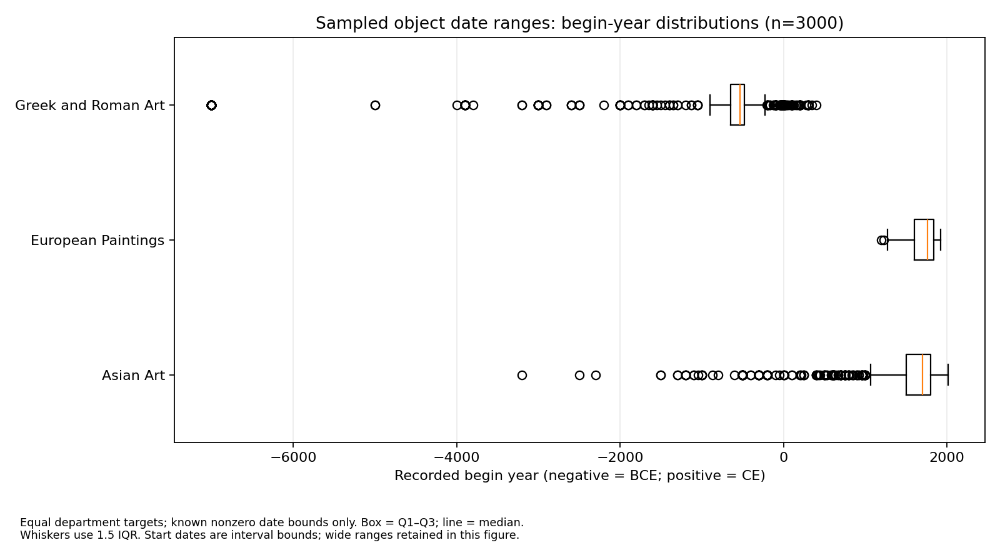

# SX-dsci-510Project

Temporal and cultural analysis of Metropolitan Museum of Art collection metadata
for an individual DSCI 510 project.

## Current checkpoint

- Acquired **3,000 unique API records**: 1,000 each from European Paintings,
  Asian Art, and Greek and Roman Art; no selected IDs remain missing.
- Implemented resumable JSON Lines caching, seeded sampling, timeouts, retries,
  logging, and a small live API demonstration.
- Completed initial pandas cleaning and Q1 NumPy summaries and visualization.
  Current date rules leave **2,990 records** eligible for Q1.
- Added a minimal Streamlit explorer with department/year filters, data-driven
  charts, and object metadata. Formal Q2 interpretation and Q3 remain unfinished.

Read the [results and limitations](reports/full_sample_results.md) and
[analysis methods](reports/analysis_method.md). This checkpoint is not the final
course report. See the [five-minute demo guide](reports/demo_guide.md) for a
rehearsal sequence.



## Setup

Use Python 3.12. From the checkout root on macOS/Linux:

```bash
python3 -m venv .venv
source .venv/bin/activate
python -m pip install -r requirements.txt
python -m unittest discover -s tests -v
```

On Windows, activate with `.venv\Scripts\Activate.ps1` in PowerShell. In the
prepared cloud environment, `/workspace/met-venv/bin/python` is already available
and can be used instead of creating another environment. No background services
or API key are required.

## Reproduce the recorded sample

The committed manifest fixes the **actual 3,000 IDs**, not just the random seed.
Restore it into the ignored data directory before acquisition:

```bash
mkdir -p data
cp -n sampling/sample_3000_510.json data/sample_3000_510.json
python acquire.py --count 3000 --interval 1
python inspect_quality.py data/sample_3000_510.json
python process_data.py data/sample_3000_510.json --output-dir data/processed_3000
```

The first two commands use macOS/Linux shell syntax. On Windows, create `data`
and copy the manifest into it using the file manager, preserving any existing
manifest. On a fresh checkout, acquisition makes real requests and can take about
50 minutes at the default rate. Existing cached IDs are skipped. Access to the
API and availability of the originally sampled IDs are required; historical
records and metadata can change.

For a new pilot instead of the recorded full sample:

```bash
python acquire.py --count 20
python acquire.py --count 300
```

Each target size has its own manifest and need not contain the smaller sample.
The default departments are European Paintings (11), Asian Art (6), and Greek
and Roman Art (13), with the total target split equally where possible.

## Live acquisition demo

```bash
python api_demo.py --department 11
```

This calls `/departments`, `/objects?departmentIds=...`, and `/objects/{objectID}`,
then prints a readable subset of one real response. It does not change the sample
or research cache. A cached acquisition re-run tests resumability and makes no
new requests; use the demo when demonstrating live API acquisition.

## Simple application

After processing the sample, start the explorer from the checkout root:

```bash
python -m streamlit run app.py --browser.gatherUsageStats=false
```

On your presentation machine, use the browser window opened by Streamlit. Select
a department and a recorded begin-year range to update all counts, summaries,
date histograms, medium-composition tables, and example metadata. The medium
view is exploratory and includes `other`/`unknown`; it is not a finalized Q2
conclusion. The app reads `data/processed_3000/objects_clean.csv`, or a custom
processed file specified by `MET_DATA_PATH`. It makes no API calls while filtering.
The processed file is not committed, so downloading the repository alone does not
supply its data: run acquisition and processing first, or use the existing cloud
cache. See the [five-minute guide](reports/demo_guide.md) to rehearse the demo.

## Code and outputs

| File | Purpose |
|---|---|
| `acquire.py` | API client, sampling, cache recovery, progress, and acquisition summaries |
| `inspect_quality.py` | Per-department missing percentages and date flags |
| `process_data.py` | Cleaning, century and medium features, Q1 statistics and figure |
| `api_demo.py` | Small live acquisition demonstration |
| `demo_snapshot.py` | Cached DataFrame examples and NumPy statistics for presentation |
| `app.py` | Streamlit department/year filters, charts, and example metadata |
| `tests/` | Mocked acquisition tests and numerical/date boundary tests |
| `sampling/` | Fixed sample IDs and acquisition metadata; no full object responses |
| `reports/results/` | Committed aggregate statistics for the verified checkpoint |
| `reports/figures/` | Committed analysis figure |

Raw responses live in ignored `data/objects.jsonl`. Generated files under
`data/processed_3000/` include `objects_clean.csv`, `date_review.csv`,
`medium_review.csv`, `medium_counts.csv`, `q1_temporal_summary.csv`,
`q1_excluding_wide_dates.csv`, `q1_date_distribution.png`, and
`processing_summary.json`. The committed aggregates and figure are checkpoint
copies of those outputs; rerunning analysis writes to the ignored data directory.
Logs and large intermediate tables are not committed.

## Request behavior and interpretation

Requests use a descriptive User-Agent, connection/read timeouts, and a default
one-second minimum interval between request starts. Network failures, HTTP 429,
and selected transient server errors receive bounded exponential retries;
integer `Retry-After` seconds are respected. Three consecutive HTTP 403 responses
stop acquisition. Partial runs exit with code 1; missing IDs include failures and
any requests not attempted after stopping. Resume with the same command rather
than replacing failed IDs. Malformed cache lines stop processing for review.

Q1 uses **recorded interval begin years**, not exact creation dates. Zero-bound,
missing, nonfinite, noninteger, or reversed intervals are excluded. Intervals
wider than 500 years are flagged and examined in a separate sensitivity summary.
Signed centuries use no ordinary year zero: -100 through -1 is century -1;
1 through 100 is century 1. Medium categories use ordered keyword matching and
retain the original text for review.

Equal department targets cannot establish full-collection proportions. Departments
contain different object types, including frames. Metadata is sampled without an
`isPublicDomain` filter; image permissions require separate checking. No images
were acquired for this checkpoint. Eleven tests passed, including three app tests; synthetic fixtures are
used only for tests, not research conclusions.

## Source

- Documentation: https://metmuseum.github.io/
- API: https://collectionapi.metmuseum.org/public/collection/v1
- Recorded full-sample acquisition began November 5, 2026 (America/Los_Angeles);
  the exact UTC start time is in the sampling manifest.
- The documentation states no API key is required and requests should be limited
  to 80 per second. The verified full run used approximately one request per
  second. Check current usage guidance before a new large run.
