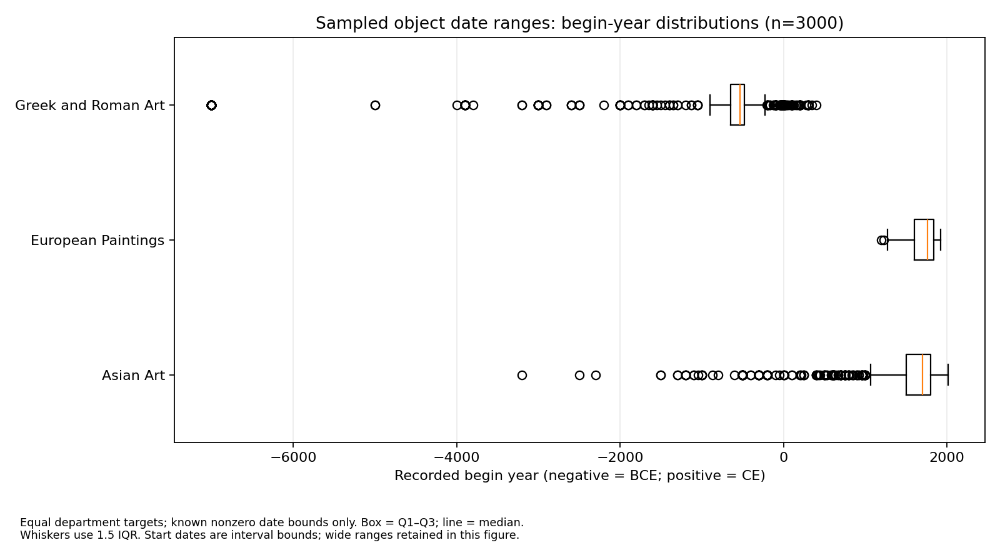

# Full sample: acquisition, cleaning, and Q1 results

## Verified checkpoint

- Acquired 3,000 unique selected records: 1,000 per department, with no missing selected IDs.
- Used the real API, seed 510, a fixed ID manifest, and an approximately one-second request interval.
- Re-running acquisition made no network calls and did not change the cache. The shared cache contained 3,206 records; this analysis selects only the 3,000 manifest IDs.
- Eleven tests passed: eight acquisition/processing tests and three app tests. The live demonstration successfully called the department, candidate-ID, and object-detail endpoints. The running Streamlit app passed real-data filtering checks and an HTTP startup check.
- A minimal Streamlit application now supports department/year filters, date summaries, exploratory medium composition, and object metadata. Formal Q2 interpretation and Q3 remain unfinished. This is a project checkpoint, not the final course report.

## Field missing percentages

| Department | Records | culture | medium | artistNationality | country |
|---|---:|---:|---:|---:|---:|
| Asian Art | 1000 | 0% | 1% | 76.4% | 100% |
| European Paintings | 1000 | 100% | 0% | 0.2% | 100% |
| Greek and Roman Art | 1000 | 4% | 0% | 100% | 100% |

Missing means absent, null, or blank. Populated dates still require validation.

## Date checks and Q1

The sample has 968 negative begin years, 10 zero begin years, no reversed intervals, and 156 intervals wider than 500 years. Nine 0/0 records without date descriptions are flagged as likely unknown. One additional zero-bound record has a BCE-to-CE description. All zero-bound intervals remain available for review rather than being assigned to a normal year zero.

The current rules leave **2,990 records** eligible for Q1. Statistics describe recorded interval **begin years**, not exact creation dates. Negative years denote BCE; positive years denote CE.

| Department | Eligible records | Median begin year | 25th percentile | 75th percentile | IQR (years) |
|---|---:|---:|---:|---:|---:|
| Asian Art | 991 | 1700 | 1500 | 1800 | 300 |
| European Paintings | 1000 | 1760 | 1600 | 1840 | 240 |
| Greek and Roman Art | 999 | -530 | -650 | -480 | 170 |

**Preliminary finding:** Within this equal-target department sample, the median recorded begin year for Greek and Roman Art is 530 BCE, earlier than Asian Art (1700 CE) and European Paintings (1760 CE). This describes sampled catalog date lower bounds, not the overall composition of art history or exact creation dates.

### Sensitivity to wide date intervals

Excluding intervals wider than 500 years preserves the median ordering but changes comparisons of distribution width:

| Department | Eligible records after exclusion | Median begin year | IQR (years) |
|---|---:|---:|---:|
| Asian Art | 961 | 1700 | 200 |
| European Paintings | 1000 | 1760 | 240 |
| Greek and Roman Art | 873 | -525 | 201 |

Asian Art's IQR falls from 300 to 200 years, while European Paintings remains at 240 years. The claim that Asian Art has a wider central temporal spread therefore depends on the treatment of imprecisely dated objects.

## Medium review and remaining work

- Initial keyword categories leave 325 records as `other` and 10 as `unknown`: 335 records (about 11.2%) need further review or explicit retention as unclassified.
- Q2 remains unfinished: inspect medium rules, then compare within-department/century medium proportions. Equal department sample sizes cannot establish collection-wide historical trends.
- Q3 remains unfinished: `country` is entirely missing, and `artistNationality` coverage differs sharply across departments. A culture-label analysis could focus on documented Asian Art and Greek and Roman Art records, reporting coverage and sample size.
- Departments include different object types, including frames. Metadata has no `isPublicDomain` filter; image use requires separate checking. No images were acquired.
- Date and medium rules are initial, documented choices. Re-run the analysis after any substantive rule revision.

## Files and reproduction

- [Fixed sample manifest](../sampling/sample_3000_510.json)
- [Field completeness](results/field_completeness.csv) and [date checks](results/date_quality.json)
- [Q1 statistics](results/q1_temporal_summary.csv) and [wide-date sensitivity](results/q1_excluding_wide_dates.csv)
- [Medium counts](results/medium_counts.csv) and [processing metadata](results/processing_summary.json)
- [Methods](analysis_method.md) and [setup/reproduction instructions](../README.md)

Raw responses, logs, full cleaned tables, and detailed Chinese learning notes are kept outside the published checkpoint. Committed CSVs and the figure are derived checkpoint outputs. Future API responses may differ even when the same IDs are used.
