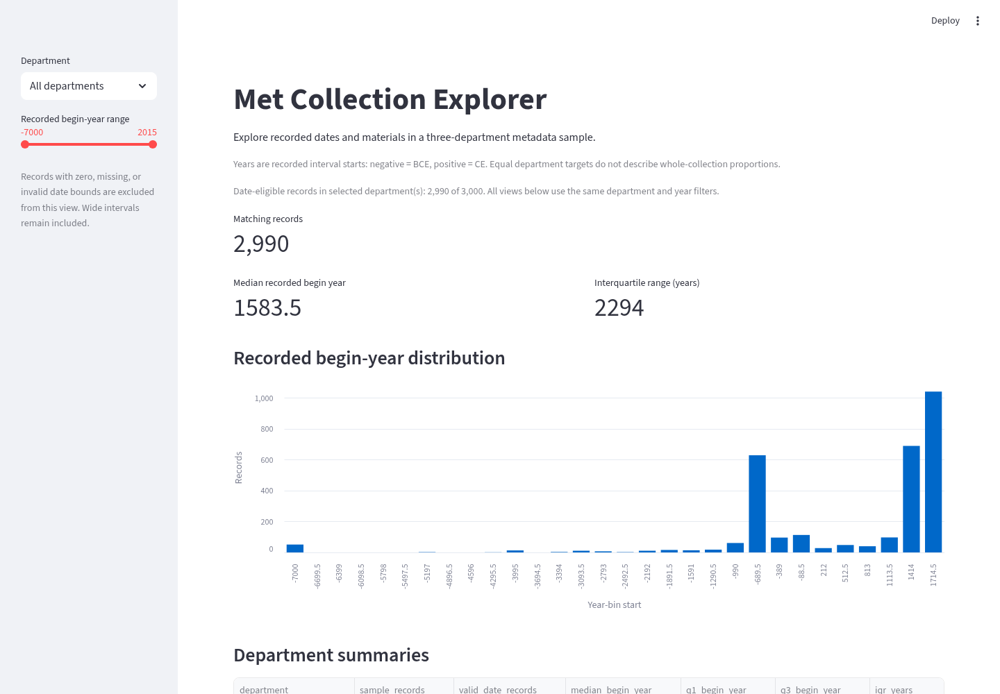
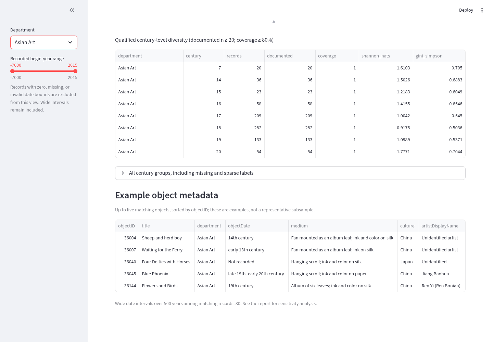

# Current interactive interface

These are real browser screenshots of the locally running Streamlit app, not
mockups. They demonstrate the current interface; they do not establish that the
hosted Community Cloud deployment is healthy.

## Overview and Q1

The sidebar selects departments and a recorded begin-year range. The page shows
matching record counts, medians, IQRs, a date histogram, and department summaries.
The default view pools the equal-target sample. Choose a department for an
individual departmental comparison.

## Q2 and Q3

Below the overview, medium composition is shown by observed century. The default
comparison requires at least 20 records per department-century. Q3 shows culture
coverage, exact-label concentration, and NumPy diversity summaries. A group with
all culture values missing has undefined diversity, not a zero value.

The screenshot below selects Asian Art. It uses 991 date-eligible records, so
its denominator differs from the whole-department Q3 report's 1,000 records.

## Object metadata

Up to five matching records are shown, sorted by objectID. These are examples,
not a representative random subsample. The current interface displays metadata
rather than an artwork-image gallery.

## Browser verification

A headless Chromium browser opened the actual app, verified the default 2,990
matching records, selected Asian Art, verified 991 records, and captured these
views. No app exceptions appeared in those flows. The public deployment remains
a separate check.
