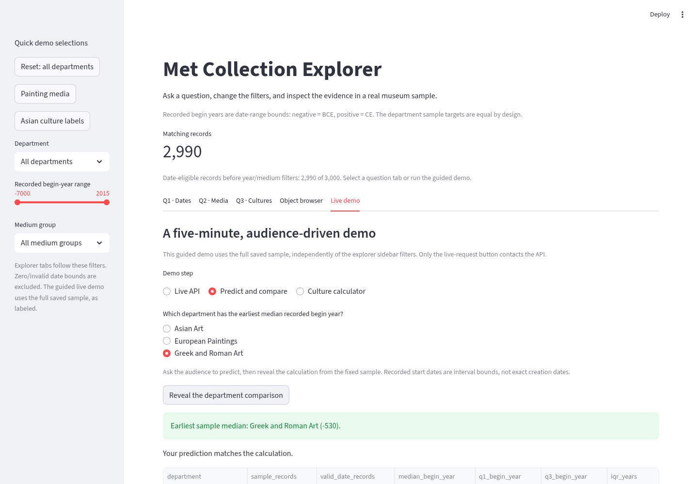
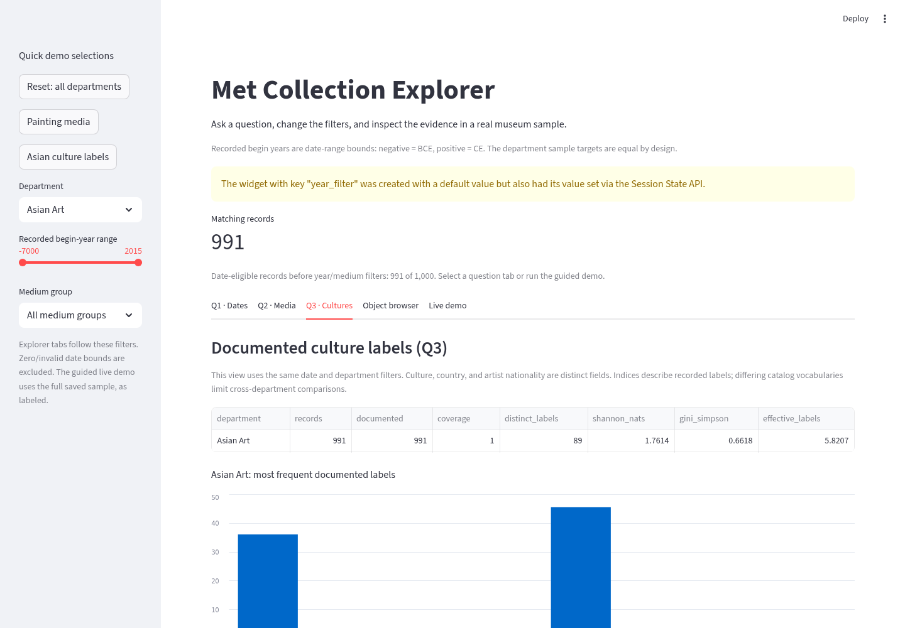

# Current interactive interface

These are real screenshots from a local Chromium browser, not mockups. The owner
reported a new hosted deployment at:
https://xsun7408-sx-dsci-510project-app-kwdahk.streamlit.app/

That hosted address is distinct from earlier failed deployments. These local
browser captures do not independently establish the hosted service's current state.

## Overview and question tabs

Use the sidebar department/year/medium filters or quick presets. Q1, Q2, Q3,
object browsing, and the guided live demo have separate tabs. The default 2,990
matching rows are the date-eligible part of the fixed 3,000-record sample.

## Predict, then reveal

In **Live demo → Predict and compare**, ask the audience for a prediction. The
reveal button computes the department medians from the full saved sample, shows
the answer and table, and offers the NumPy calculation. The guided demo's full
sample scope is stated separately from sidebar-filtered explorer views.

The **Live API** step makes one bounded, uncached object-detail request on click.
A browser test received a fresh actual Met response. A failed refresh clears old
success and labels saved evidence explicitly; this is also covered by tests.

## Culture explorer

Q3 shows label coverage, concentration, and indices for the current explorer
filters. The culture calculator in the guided demo uses the full chosen department
and supports uncertain-attribution exclusion. All-missing culture groups are
undefined, not zero-diversity groups.

The Asian Art explorer screenshot uses 991 date-eligible records; the whole-
department report and guided calculator use 1,000 records and can therefore differ.

## Search and select an object

Search titles or artists, then choose one of the first 100 matching IDs to inspect
its metadata. The displayed examples are not a representative random subsample.
Object search applies only to this browser, not the statistical analyses.

## Validation

Twenty-seven automated tests passed. Real-browser checks covered tab navigation,
prediction and reveal, a successful fresh API request, presets, and an object
search with a matching real title. No unhandled app exceptions appeared in the
completed checks. Hosted API reachability and online app startup remain dependent
on the actual deployment environment.
