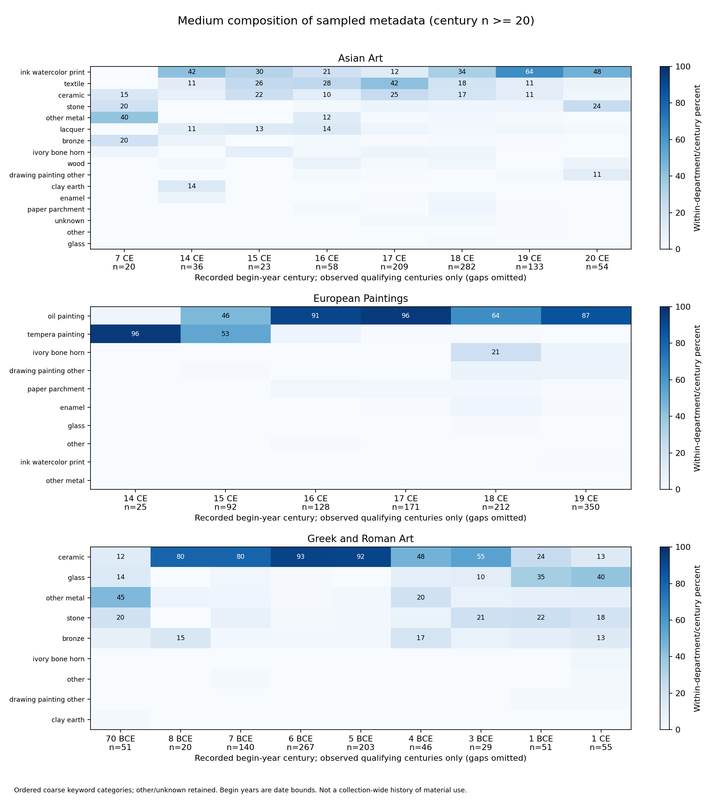

# Q2: How does medium composition vary across recorded centuries?

## Population and method

The analysis uses 2,990 date-eligible records from the fixed 3,000-object sample. Each department-century is normalized separately with NumPy broadcasting. All observed groups are saved; the main figure and endpoint contrasts require n >= 20. Unknown and other categories remain in the denominator.



## Earliest and latest qualifying centuries

These endpoints describe the observed sample and can be far apart. They do not establish a continuous historical trend.

| Department | Century | Records | Most frequent category | Count | Share |
|---|---|---:|---|---:|---:|
| Asian Art | 7 CE | 20 | other_metal | 8 | 40.0% |
| Asian Art | 20 CE | 54 | ink_watercolor_print | 26 | 48.1% |
| European Paintings | 14 CE | 25 | tempera_painting | 24 | 96.0% |
| European Paintings | 19 CE | 350 | oil_painting | 303 | 86.6% |
| Greek and Roman Art | 70 BCE | 51 | other_metal | 23 | 45.1% |
| Greek and Roman Art | 1 CE | 55 | glass | 22 | 40.0% |

**Descriptive finding:** In sampled European Paintings records, the most frequent category changes from tempera_painting (24/25, 96.0%) in recorded begin-century 14 CE to oil_painting (303/350, 86.6%) in 19 CE. This supports a difference in sampled catalog composition, not a causal or collection-wide account of artistic evolution.

## Sensitivity and limitations

Excluding intervals wider than 500 years leaves 2,834 date-eligible records. Comparisons below include only department-centuries with sufficient sample sizes in both treatments.
- Threshold-sensitive group: Asian Art, 7 CE falls from n=20 to n=19 after wide-date exclusion; its endpoint or apparent prominence should not be treated as a stable century-specific finding.
- Threshold-sensitive group: Greek and Roman Art, 70 BCE falls from n=51 to n=0 after wide-date exclusion; its endpoint or apparent prominence should not be treated as a stable century-specific finding.
- Asian Art: largest absolute category change is 2.5 percentage points (bronze, 14 CE: 5.6% to 3.0%).
- European Paintings: largest absolute category change is 0.0 percentage points (bronze, 14 CE: 0.0% to 0.0%).
- Greek and Roman Art: largest absolute category change is 7.2 percentage points (ceramic, 7 BCE: 80.0% to 87.2%).

- Department sample sizes are fixed by design; pooled counts cannot describe the museum's actual department proportions.
- These are descriptive comparisons of catalog date lower bounds; century assignment can be uncertain for wide or cross-century intervals. This check does not resolve every date uncertainty.
- The n >= 20 rule limits sparse comparisons, but does not guarantee precision or statistical significance. Small groups remain in the CSV.
- Medium categories mix technique and material using a documented priority. Composite media may fit multiple patterns; a first match is an analytic convention, not a definitive catalog classification.
- Missing or unmatched medium text is retained. A high percentage within a century does not imply worldwide artistic dominance.

## Reproduce

```bash
python process_data.py data/sample_3000_510.json --output-dir data/processed_3000
python analyze_media.py --data data/processed_3000/objects_clean.csv --output-dir reports
```

Outputs include full counts/proportions, a wide-date sensitivity table, medium-rule audit, figure, and this report.
