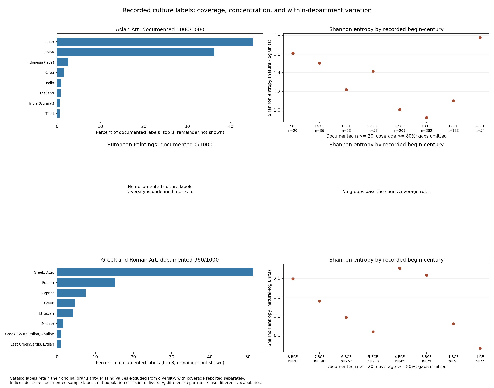

# Q3: Which culture labels are represented, and how concentrated are they?

## Revised question and interpretation

The proposal mentioned artist nationalities and geographic origins. Coverage checks showed that these fields cannot support a uniform three-department comparison. Q3 therefore describes the actual `culture` catalog labels, retaining compound labels such as `Greek, Attic` and `China or Japan`. These are not interchangeable with countries, artist nationality, or societal diversity.

Department summaries use all sampled records, including those without usable dates. Century summaries use only date-eligible records. Missing labels are excluded from index denominators and reported separately. Whitespace is normalized; no geopolitical or ethnic recoding is applied.

## Coverage and departmental descriptive statistics

| Department | Sample n | Documented n | Coverage | Distinct labels | Shannon H | Gini-Simpson | Effective labels |
|---|---:|---:|---:|---:|---:|---:|---:|
| Asian Art | 1000 | 1000 | 100.0% | 89 | 1.764 | 0.663 | 5.836 |
| European Paintings | 1000 | 0 | 0.0% | 0 | undefined | undefined | undefined |
| Greek and Roman Art | 1000 | 960 | 96.0% | 66 | 2.033 | 0.703 | 7.636 |

**Missing does not mean zero diversity.** European Paintings has no documented culture labels in this sample; its indices are undefined. Artist-nationality values are not substituted into this field.

## Most frequent documented labels

| Department | Catalog label | Records | Share among documented records |
|---|---|---:|---:|
| Asian Art | Japan | 452 | 45.2% |
| Asian Art | China | 363 | 36.3% |
| Asian Art | Indonesia (Java) | 25 | 2.5% |
| Greek and Roman Art | Greek, Attic | 493 | 51.4% |
| Greek and Roman Art | Roman | 145 | 15.1% |
| Greek and Roman Art | Cypriot | 72 | 7.5% |

**Descriptive conclusion:**

- Asian Art: the two most frequent documented labels are Japan (452), China (363); together they account for 81.5% of documented records. This is concentration in catalog labeling, not the true distribution of cultures or geographic origins.
- Greek and Roman Art: the two most frequent documented labels are Greek, Attic (493), Roman (145); together they account for 66.5% of documented records. This is concentration in catalog labeling, not the true distribution of cultures or geographic origins.

## NumPy computation

For each group, counts are normalized with broadcasting. Shannon H = -sum(p * ln(p)); Gini-Simpson = 1 - sum(p**2); exp(H) is an effective number of equally frequent labels. Zero probabilities contribute zero without evaluating ln(0). An all-missing group returns undefined indices, not H=0. No library diversity helper is used.



Of 80 observed date-eligible department-century groups, 16 meet both documented n >= 20 and coverage >= 80%. All groups remain in the CSV; this threshold is a descriptive guardrail, not a guarantee of precision or significance.

## Sensitivity and limitations

- When excluding date spans over 500 years, 15 groups qualify in both treatments.
  Largest absolute Shannon change among those groups: 0.316 nats (Greek and Roman Art, 7 BCE).
  Threshold-sensitive group: Asian Art, 7 CE no longer qualifies.
- When excluding explicitly uncertain attributions, 16 groups qualify in both treatments.
  Largest absolute Shannon change among those groups: 0.319 nats (Greek and Roman Art, 1 BCE).

- Exact labels have different granularity across departments; an index ranking is not evidence that one historical society was more diverse.
- Observed richness/entropy depend on sample size and catalog practice. Century sample sizes differ; no rarefaction or population-diversity inference is claimed.
- Uncertain attributions are not split into invented multiple records. The sensitivity check excludes labels containing or, possibly, probably, perhaps, ?, or attributed. Commas alone do not imply uncertainty; Greek, Attic remains intact.
- Begin years are interval bounds; excluding extremely wide ranges does not eliminate all dating uncertainty.

## Reproduce

```bash
python analyze_cultures.py
```

Outputs: department coverage/statistics, full century summaries, documented-label counts, uncertain-label counts, sensitivity tables, a figure, and this report. The committed compact snapshot is sufficient; no fresh API requests are needed.
